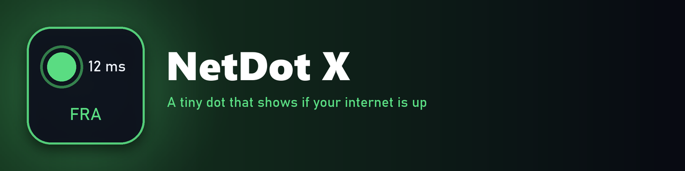

  
  
  

**NetDot X** is a small dot for your desktop that shows whether your internet works, at a glance.

## What it does

- **Pings the nearest Cloudflare server** (1.1.1.1) every second and shows the time in milliseconds.
- **The dot changes color** with the ping: good, slow, or down. You choose what counts as good and slow.
- **Follows you anywhere.** 1.1.1.1 always reaches the closest Cloudflare data center, so it works on a laptop, a friend's PC or a VPN without any setup.
- **Shows where you're connected.** Every 10 minutes it checks which Cloudflare data center you reach and briefly shows its code (like `FRA`) when it changes.
- **Falls back to 1.0.0.1** if 1.1.1.1 is blocked on your network.

## Settings

Open `NetDot.ini`, change the values under `[Variables]`, then refresh the skin:

| Setting | Default | What it does |
|---|---|---|
| `GoodLatency` | `100` | Pings at or under this (ms) count as good |
| `BadLatency` | `300` | Pings over this (ms) count as bad |
| `TraceInterval` | `600` | Seconds between data center checks |
| `ColoFlashSeconds` | `30` | How long the data center code stays on screen |

## Install

Download the `.rmskin` file from **[Releases](https://github.com/SteelArchadian/NetDot-X/releases/latest)** and double-click it. Rainmeter installs and loads it.

## Credits and license

Made by SteelArchadian, under the [GNU GPL v3.0](LICENSE).

Made with help from Claude (an AI).

## Bugs and ideas

Post them on [GitHub Issues](https://github.com/SteelArchadian/NetDot-X/issues).
